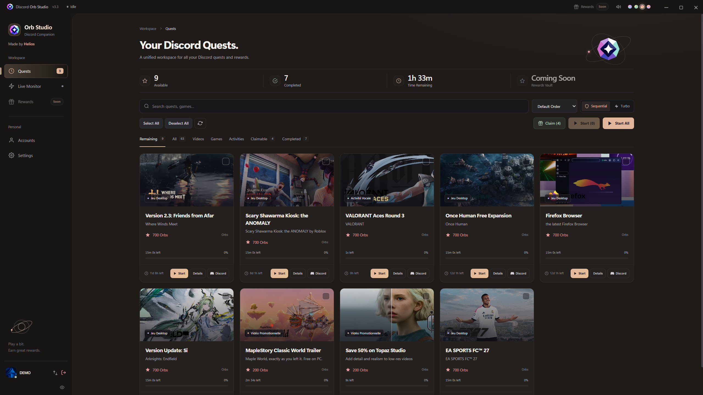
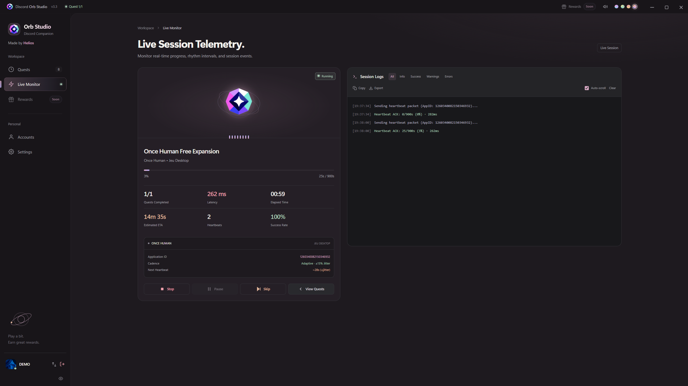
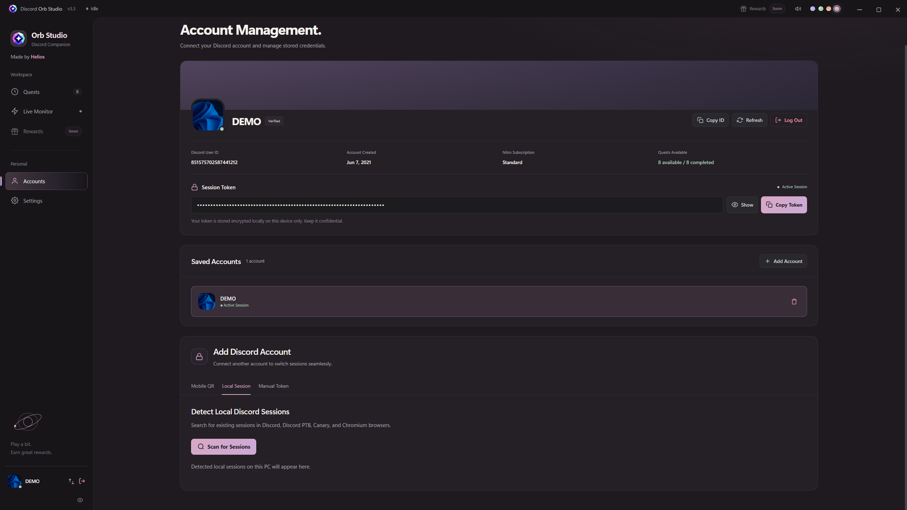
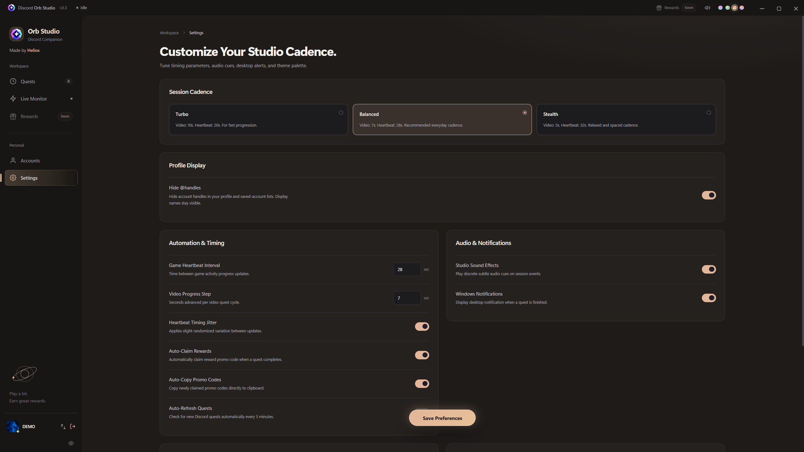

# Discord Orb Studio

<div align="center">
  
  <h3>Desktop Companion for Discord Quests & Rewards</h3>
  <p>A lightweight, modern desktop application designed to track, automate, and claim Discord quests and rewards without launching or installing heavy game clients.</p>

  <p>
    <a href="https://github.com/SamChico2008/Discord-Orbs-Studio/releases/latest"></a>
    <a href="https://github.com/SamChico2008/Discord-Orbs-Studio/releases/latest"></a>
    <a href="https://www.electronjs.org/"></a>
    <a href="https://nodejs.org/"></a>
    <a href="LICENSE"></a>
    <a href="https://github.com/SamChico2008"></a>
  </p>
</div>

---

## Educational Purpose Disclaimer

> [!IMPORTANT]
> **For educational and research purposes only.**
>
> Discord Orb Studio is an independent project for studying desktop application development, automation, and interactions with online services. It is not affiliated with, endorsed by, or sponsored by Discord Inc.
>
> Use this software only with accounts and systems you are authorized to access. You are responsible for complying with Discord's Terms of Service, quest eligibility requirements, and applicable rules. This project does not guarantee rewards, account safety, or protection against account restrictions.
>
> The software is provided **"as is," without warranty**, under the [MIT License](LICENSE).

## Download

Get the Windows installer from **[GitHub Releases](https://github.com/SamChico2008/Discord-Orbs-Studio/releases/latest)**. The packaged application includes Electron and its embedded Node.js runtime; a separate Node.js installation is only needed for development.

---

## Interface Preview

<div align="center">
  
  
  
  
</div>

---

## Key Features

- **Background Quest Processing**: Complete gaming and video quests autonomously with heartbeat packet scheduling and activity session simulation.
- **Interactive Orbital Visualizer**: Real-time progress monitoring featuring rotating orbital rings and a synchronized live equalizer.
- **Dynamic Multi-Color Themes**: Personalize the workspace with four color schemes (*Periwinkle*, *Sage*, *Peach*, *Rose*) that dynamically adapt accent glows, button states, and progress indicators.
- **Refined Ergonomics**: Centered floating action button for saving preferences, on-demand client build info toggle, and smooth view transitions.
- **Accounts & Session Controls**: Switch between saved accounts, use QR code or session token login, and choose session cadence and speed presets.
- **Streamlined Native Installer**: Windows 10 & 11 setup wizard with custom branding, English localization, and destination directory selection.

### Prepared for the Next Release

The next desktop release includes these additions. They become available to users after that release and its installer are published:

- **Update prompts for every installation**: The app checks the public GitHub release feed at startup and every 15 minutes while running. Users choose **Update Now** or **Later** before installation.
- **Installed version in the title bar**: The interface displays the full version of the running application and refreshes it after an upgrade.
- **What's new after an update**: A popup on the main interface summarizes the installed release. Its notes remain available offline and are shown once per version after dismissal.

---

## Project Structure

```text
DISCORD ORB APP/
├── desktop-app/              # Main desktop application (Electron)
│   ├── src/                  # Interface, styles, and renderer logic
│   ├── assets/               # Icons, branding, and installer assets
│   ├── main.js               # Electron main process
│   ├── preload.js            # Bridge between the interface and main process
│   ├── update-manager.js     # Update checks and installer handoff
│   ├── quest-engine.js       # Autonomous quest execution engine
│   ├── qr-auth.js            # QR code authentication module
│   └── package.json          # Desktop dependencies and build settings
├── docs/screenshots/         # Interface previews used in this README
├── LICENSE                   # Open-source MIT license
└── README.md
```

---

## Quick Start

### Prerequisites

- **Node.js 24.22.1 or newer**
- **npm** (included with Node.js)
- Operating System: **Windows 10 / 11 (64-bit)**

### 1. Install Dependencies

```bash
npm --prefix desktop-app ci
```

### 2. Run in Development

```bash
npm start
```

---

## Building & Distribution

### Generate the Windows Installer

From the repository root:

```bash
npm run build
```

The installer is written to the root `dist/` directory. The next release uses the versioned filename `Discord.Orb.Studio.Setup.<version>.exe`.

### Publish Future Updates

Increase the desktop package version, prepare the release summary, and build the installer. Publish a stable GitHub Release whose version tag matches the installer, and attach that installer to it. The upcoming updater uses published Releases rather than individual commits. The repository and release assets must be publicly accessible to installed applications.

---

## Privacy & Security

- Session tokens are stored in Orb Studio’s local configuration file on this device; protect access to your Windows account.
- Orb Studio connects to Discord services to validate sessions and provide quest and reward features. The app does not include a third-party analytics service.

---

## License & Author

This project is open-source software licensed under the **[MIT License](LICENSE)**.

Developed and maintained by **Helios** (2026).
