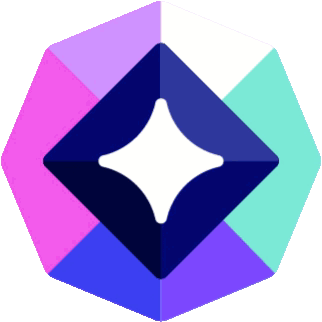

# Discord Orb Studio

<div align="center">
  
  <h3>Desktop Companion for Discord Quests & Rewards</h3>
  <p>A lightweight, modern desktop application designed to track, automate, and claim Discord quests and rewards without launching or installing heavy game clients.</p>

  <p>
    
    
    
    
    
  </p>
</div>

---

## Key Features

- **Background Quest Processing**: Complete gaming and video quests autonomously with heartbeat packet scheduling and activity session simulation.
- **Interactive Orbital Visualizer**: Real-time progress monitoring featuring rotating orbital rings and a synchronized live equalizer.
- **Dynamic Multi-Color Themes**: Personalize the workspace with four color schemes (*Periwinkle*, *Sage*, *Peach*, *Rose*) that dynamically adapt accent glows, button states, and progress indicators.
- **Refined Ergonomics**: Centered floating action button for saving preferences, on-demand client build info toggle, and smooth view transitions.
- **Multi-Account & Privacy Controls**: Multiple operational modes (*Turbo* or *Balanced*), fingerprint management, and secure multi-account switching with password or QR code login.
- **Modern Full-Screen Setup Wizard**: Custom Windows 10 & 11 installer featuring native DWM dark mode, high-definition vector graphics, and integrated directory selection.

---

## Project Structure

```text
DISCORD ORB APP/
├── desktop-app/              # Main desktop application (Electron)
│   ├── src/                  # User interface, styles, and renderer logic
│   │   ├── index.html        # Main application layout
│   │   ├── app.js            # UI controller and event bindings
│   │   ├── ui-redesign.css   # Base application styles
│   │   └── ui-theme-plus.css # Dynamic themes, animations, and floating controls
│   ├── assets/               # Application icons, graphics, and NSIS scripts
│   │   ├── icon.ico / .png   # Brand identity assets
│   │   ├── installer.nsh     # Modern NSIS custom wizard script
│   │   └── installerBanner.bmp
│   ├── main.js               # Electron main process
│   ├── quest-engine.js       # Autonomous quest execution engine
│   └── qr-auth.js            # QR code authentication module
├── research/                 # Reverse-engineering and API inspection scripts
│   ├── inspect_heartbeat.js  # Telemetry and session monitoring
│   └── test_increment.js
├── dummy-games/              # Game simulation mocks for local verification
└── README.md
```

---

## Quick Start

### Prerequisites
- **Node.js** (version 24 or newer recommended)
- **npm** (included with Node.js)
- Operating System: **Windows 10 / 11 (64-bit)**

### 1. Install Dependencies
```bash
cd desktop-app
npm install
```

### 2. Run in Development
```bash
npm start
```
*Alternatively, run `Lancer-Discord-Orb-Studio.bat` from the root directory.*

---

## Building & Distribution

### Generate Production Installer (`Setup.exe`)
To package the standalone installer:
```bash
cd desktop-app
npm run build
```
*Or execute `Compiler-Nouveau-Exe.bat` directly.*

The generated executable will be placed in:
`dist/Discord Orb Studio Setup.exe`

---

## Privacy & Security

- User credentials and session tokens are encrypted and retained locally on your machine.
- No personal data or telemetry is transmitted to third-party servers.
- Heartbeat emulation matches official Discord protocol structures to ensure account safety and stability.

---

## License

Developed by: Helios
